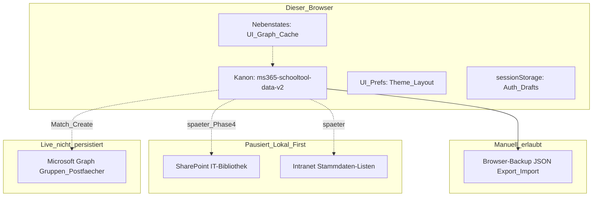
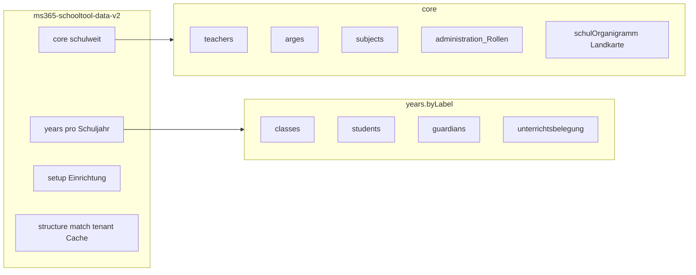
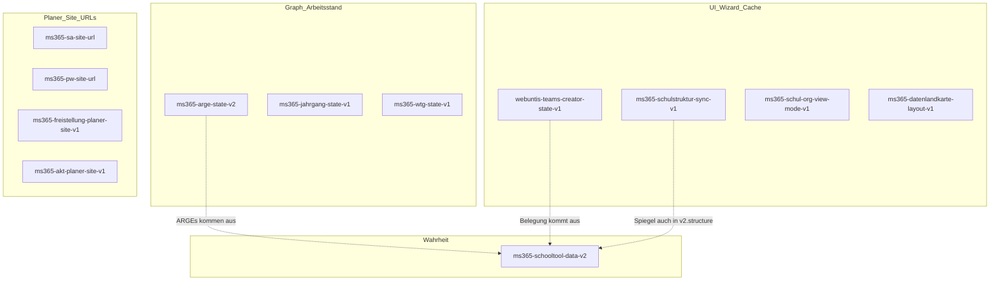
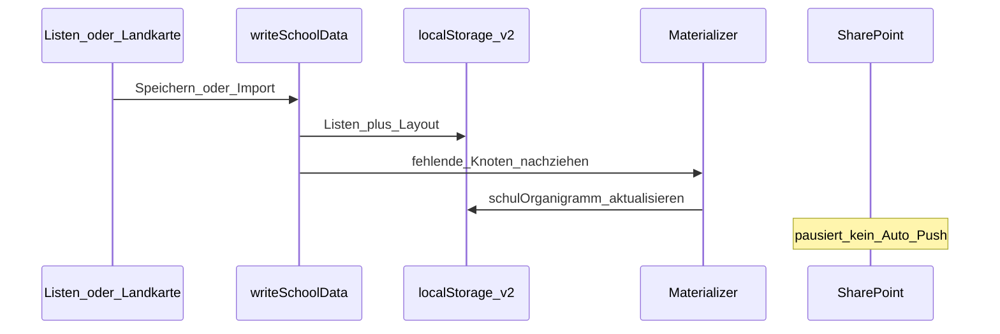

# Daten-Inventar-Landkarte

**Zweck:** Übersicht, **wo** welche Schul-/App-Daten physisch liegen – nicht die Live-Zähler der App.

| Werkzeug / Doc | Aufgabe |
|----------------|---------|
| **Diese Seite** | Inventar: Speicherorte, Wahrheit vs. Cache, was während Lokal-First aktiv ist |
| [Datenlandkarte](datenlandkarte.md) (App: `tools/datenlandkarte.html`) | Visuelle Blöcke mit **Anzahlen** und Sync-Linien zwischen Listen |
| [Schul-Landkarte / Organigramm](schul-organigramm-landkarte.md) | **Pflege** der Schulstruktur (schreibt Stammdaten) |
| [Lokal-First](stammdaten-local-first.md) | Umbau-Status: SPO/Intranet pausiert |

---

## 1. Grobbild (Lokal-First, Stand Umbau)

**Merksatz:** Alles Wichtige für Schule und Landkarte steckt in **einem** localStorage-Schlüssel (`ms365-schooltool-data-v2`). Alles andere ist Cache, Site-URL, oder später wieder SPO.

---

## 2. Kanonischer Container (Wahrheit)

Schlüssel: `ms365-schooltool-data-v2`  
Code: [`app-data-v2.js`](../src/shared/app-data-v2.js), Schreiben: [`stammdaten-write.js`](../src/shared/stammdaten-write.js)

| Bereich | Inhalt | Rolle |
|---------|--------|--------|
| `core.teachers` / `arges` / `subjects` / … | Listen | Entitäten-Wahrheit |
| `core.schulOrganigramm` | Baum, Position, `refKind`/`refKey`, M365-Bindung | Struktur-Wahrheit |
| `years.*.classes` / `students` / … | schuljahrbezogen | Entitäten-Wahrheit |
| `years.*.unterrichtsbelegung` | Kursteams-Zuordnung | Entitäten-Wahrheit |
| `setup.*` | Intranet-URL, Matches, Import-Historie, IT-Meta | Konfiguration |
| `structure` / `match` / `tenant.cache` | Schulstruktur-Sync | **Cache** im Container |

Legacy-Schlüssel `ms365-tenant-settings-v1`: **nur noch lesen/migrieren**, nicht schreiben ([Sunset](stammdaten-v1-sunset.md)).

---

## 3. Was lokal noch daneben liegt (kein Stammdaten-Kanon)

Katalog im Code: [`stammdaten-side-state-keys.js`](../src/shared/stammdaten-side-state-keys.js)  
Vollständiges Backup-Inventar: [`browser-backup.js`](../src/shared/browser-backup.js) (`STORAGE_CATALOG`)

| Typ | Beispiele | Darf Stammdaten ersetzen? |
|-----|-----------|---------------------------|
| Graph-Arbeitsstand | ARGE-/Jahrgang-/WTG-State | Nein |
| UI-/Wizard-Cache | Kursteams-Creator, Organigramm-Ansicht | Nein |
| Planer-Site-Keys | `ms365-sa-site-url`, … | Nein (nur Site-Ziel) |
| Theme / Dashboard | `ms365-theme-v1`, … | Nein |

---

## 4. Fluss beim Speichern (Lokal-First)

Sicherung heute: **Browser-Backup → Exportieren** (alle `ms365-*` / `webuntis-*` Keys als JSON).

---

## 5. Unterschied zur App-Datenlandkarte

Die **App-Datenlandkarte** zeigt z. B. „12 Klassen · 340 Schüler“ und Linien „Schüler → Klasse“. Sie erklärt nicht, dass Klassen in `years.byLabel` und die Hierarchie in `schulOrganigramm` stecken.

Diese **Inventar-Landkarte** erklärt die Speicherorte und die Regel „ein Schreibpfad“. Beide ergänzen sich:

1. Entwickler / Architektur → dieses Doc  
2. Schule / Überblick Zahlen → `tools/datenlandkarte.html`  
3. Struktur pflegen → Schul-Organigramm / Landkarte  

---

## 6. Kurzes Inventar (Checkliste)

**Aktiv & lokal (Wahrheit)**

- [x] `ms365-schooltool-data-v2` – Core, Years, Organigramm, Setup  
- [x] Manuelles Browser-Backup (JSON)

**Lokal, aber nur Cache / Arbeitsstand**

- [x] ARGE / Jahrgang / WTG / Kursteams-State-Keys  
- [x] Schulstruktur-Sync-Keys  
- [x] Planer-Site-URLs, UI-Layouts

**Pausiert (Lokal-First)**

- [ ] IT-Bibliothek Auto-Sync / Upload  
- [ ] Intranet-Stammdaten-Listen-Export  

**Nicht lokal gespeichert**

- [ ] Graph-Mitgliederlisten (live)  
- [ ] MSAL-Tokens (session, bewusst nicht im Backup)
